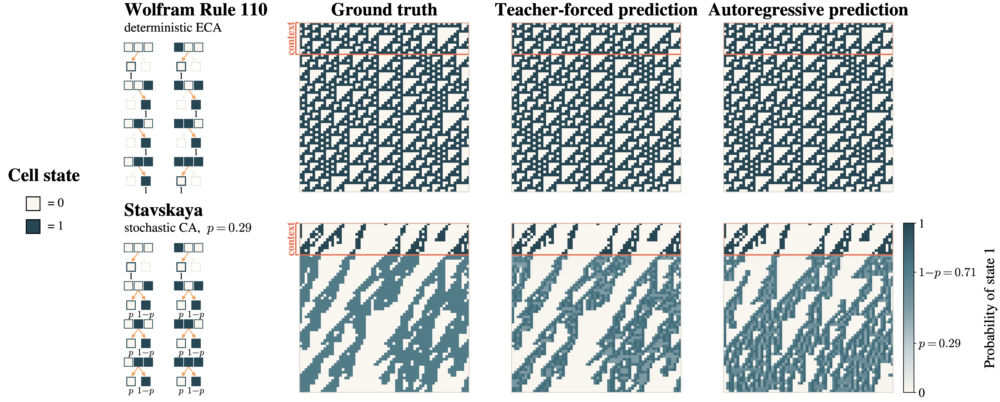
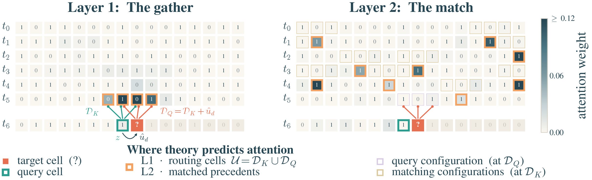

# Spatial Induction Heads: In-Context Learning of Multidimensional Cellular Automata

<p align="center">
  
</p>

<p align="center">
  <strong>Official repository for:</strong><br>
  <strong>Spatial Induction Heads: In-Context Learning of Multidimensional Cellular Automata</strong>
</p>

<p align="center">
  <a href="https://arxiv.org/abs/2610.09124">📄 arXiv</a> •
  <a href="https://kimzemian.github.io/spatial-induction-heads/">🌐 Website</a> •
  <a href="https://huggingface.co/collections/sdeangroup/spatial-induction-heads">🤗 Models</a> •
  <a href="https://github.com/sdean-group/ICL-CA">💻 GitHub</a>
</p>

---

## What's this about?

Cellular automata (CA) are grids of cells that all update with the same local rule: each
cell's next state depends only on its neighborhood. We train small transformers to do
**in-context learning of CA rules**. The model sees the first $M$ frames of a trajectory and
has to predict the rest. At test time the rules are ones it has **never seen during
training**, so the only way to do well is to work out the rule from the context.

The catch is that a transformer reads the grid as a flat sequence of tokens, so cells that
are neighbors in space can end up far apart in the sequence, especially in 2D. The figure
above shows that small two-layer models handle it anyway:

* **Top:** Wolfram Rule 110, a deterministic rule.
* **Bottom:** the Stavskaya automaton, a stochastic rule. The predictions are colored by the
  probability the model gives to state 1.

Both rules are held out from training. *Teacher-forced* predictions see the true history at
every step. *Autoregressive* predictions see only the context and then roll forward on their
own.

### How do they do it? Spatial induction heads

<p align="center">
  
</p>

The paper's answer is a two-layer circuit we call a **spatial induction head**:

* **Layer 1, the gather.** Each cell uses relative positions to pull in the cells of its
  spatial neighborhood from the previous frame, even though those cells sit far away in the
  flattened sequence. In the figure these are the *routing cells*.
* **Layer 2, the match.** The model compares the current neighborhood with every earlier
  place where the same configuration appeared, and averages what came next. For stochastic
  rules this is just Bayesian counting.

The figure shows the real attention weights of a trained model on Rule 110. They land
right where the construction says they should.

On rules never seen in training, the trained models make near-perfect autoregressive
rollouts on deterministic rules, in both 1D and 2D. On stochastic rules they stay within
0.005 nats KL of the Bayes-optimal predictor. The paper and the
[website](https://kimzemian.github.io/spatial-induction-heads/) have the full story.

### What's in this repo

We cover three tasks:

* **1D, $V{=}2$ states**, 3-cell neighborhood (the elementary CAs, Rule 110 and friends);
* **1D, $V{=}3$ states**, 3-cell neighborhood;
* **2D, $V{=}2$ states**, 5-cell von Neumann neighborhood.

Each task comes in a **deterministic** version (a fixed lookup table) and a **stochastic**
version (each neighborhood maps to a distribution over next states). For each of the six
tasks we release two 2-layer architectures:

* **Shared head**: one attention head per layer, MLP in both layers.
* **Dedicated heads**: layer 1 is attention-only with one head per neighbor; layer 2 is a
  single head plus an MLP.

This repo has everything you need to load the 12 released models and play with them,
regenerate the datasets, retrain any model from scratch, and evaluate it.

---

## Table of Contents

- [Released models](#released-models)
- [Installation](#installation)
- [Quick Start](#quick-start)
- [Data generation](#data-generation)
- [Configuration](#configuration)
- [Training](#training)
- [Evaluation](#evaluation)
- [Repository structure](#repository-structure)
- [Citation](#citation)

---

## Released models

All 12 checkpoints are in the
[spatial-induction-heads collection](https://huggingface.co/collections/sdeangroup/spatial-induction-heads)
on the Hugging Face Hub. In the code you refer to them by the short key in the first column.
They download automatically the first time you load them.

| Key | Task | Grid | $T$ / $M$ | Arch | $d_\text{model}$ | 🤗 |
|---|---|---|---|---|---|---|
| `1d-det-v2k3-shared` | 1D det, $V{=}2$ | 16 | 10 / 4 | Shared | 128 | [🤗](https://huggingface.co/sdeangroup/CA-Transformer-1D-Det-V2K3-Shared) |
| `1d-det-v2k3-dedicated` | 1D det, $V{=}2$ | 16 | 10 / 4 | Dedicated | 128 | [🤗](https://huggingface.co/sdeangroup/CA-Transformer-1D-Det-V2K3-Dedicated) |
| `1d-det-v3k3-shared` | 1D det, $V{=}3$ | 32 | 12 / 8 | Shared | 256 | [🤗](https://huggingface.co/sdeangroup/CA-Transformer-1D-Det-V3K3-Shared) |
| `1d-det-v3k3-dedicated` | 1D det, $V{=}3$ | 32 | 12 / 8 | Dedicated | 256 | [🤗](https://huggingface.co/sdeangroup/CA-Transformer-1D-Det-V3K3-Dedicated) |
| `2d-det-v2k5-shared` | 2D det, $V{=}2$ | 6×6 | 12 / 8 | Shared | 1024 | [🤗](https://huggingface.co/sdeangroup/CA-Transformer-2D-Det-V2K5-Shared) |
| `2d-det-v2k5-dedicated` | 2D det, $V{=}2$ | 6×6 | 12 / 8 | Dedicated | 1024 | [🤗](https://huggingface.co/sdeangroup/CA-Transformer-2D-Det-V2K5-Dedicated) |
| `1d-stoch-v2k3-shared` | 1D stoch, $V{=}2$ | 16 | 20 / 10 | Shared | 256 | [🤗](https://huggingface.co/sdeangroup/CA-Transformer-1D-Stoch-V2K3-Shared) |
| `1d-stoch-v2k3-dedicated` | 1D stoch, $V{=}2$ | 16 | 20 / 10 | Dedicated | 128 | [🤗](https://huggingface.co/sdeangroup/CA-Transformer-1D-Stoch-V2K3-Dedicated) |
| `1d-stoch-v3k3-shared` | 1D stoch, $V{=}3$ | 16 | 20 / 10 | Shared | 256 | [🤗](https://huggingface.co/sdeangroup/CA-Transformer-1D-Stoch-V3K3-Shared) |
| `1d-stoch-v3k3-dedicated` | 1D stoch, $V{=}3$ | 16 | 20 / 10 | Dedicated | 256 | [🤗](https://huggingface.co/sdeangroup/CA-Transformer-1D-Stoch-V3K3-Dedicated) |
| `2d-stoch-v2k5-shared` | 2D stoch, $V{=}2$ | 6×6 | 20 / 10 | Shared | 1024 | [🤗](https://huggingface.co/sdeangroup/CA-Transformer-2D-Stoch-V2K5-Shared) |
| `2d-stoch-v2k5-dedicated` | 2D stoch, $V{=}2$ | 6×6 | 20 / 10 | Dedicated | 512 | [🤗](https://huggingface.co/sdeangroup/CA-Transformer-2D-Stoch-V2K5-Dedicated) |

$T$ is the number of frames in a trajectory and $M$ is how many of them the model gets as
context. The test numbers we report in the paper for every model are in
[`configs/paper_results.json`](configs/paper_results.json).

---

## Installation

You just need Python ≥ 3.9 and PyTorch. Training needs a CUDA GPU, and a GPU helps for full
evaluation, but the Quick Start runs fine on a laptop CPU.

```bash
git clone https://github.com/sdean-group/ICL-CA.git
cd ICL-CA

conda create -n ca python=3.11 -y
conda activate ca

# Install a PyTorch build that matches your NVIDIA driver first (see https://pytorch.org),
# e.g. for CUDA 12.8:
pip install torch --index-url https://download.pytorch.org/whl/cu128

pip install -e .
```

Do install PyTorch first. If you skip that step, pip picks the newest CUDA build, which
may need a newer driver than your machine has. In that case `torch.cuda.is_available()`
returns `False` and training refuses to start. On a CPU-only machine (Quick Start and
evaluation only), plain `pip install -e .` is fine.

That installs `torch`, `numpy`, `matplotlib`, `huggingface_hub` and `pyyaml`. The code
itself lives in `src/`, so after this you can `import src` from anywhere. W&B is optional:
`pip install wandb` if you want to log runs (more on that [below](#training)).

---

## Quick Start

The easiest way in is the notebook [`quickstart.ipynb`](quickstart.ipynb). It downloads a
single checkpoint and takes a few minutes on a CPU. It walks through:

1. listing and loading a released model;
2. generating a test example from a held-out rule;
3. running the model teacher-forced and autoregressively;
4. plotting predictions next to the ground truth;
5. giving the model **your own rule and context** and checking what it predicts.

```bash
pip install jupyterlab
jupyter lab quickstart.ipynb
```

To try a different model, change `MODEL` in the second section and re-run.

If you'd rather stay in Python, here's the short version:

```python
from src import load_pretrained, generate_example, predict, plot_prediction

bundle = load_pretrained("1d-det-v2k3-shared")             # downloads from the Hub, cached afterwards
example = generate_example(bundle.spec, rule=110, seed=0)  # rule 110 is never seen in training
result = predict(bundle, example)                          # teacher-forced + autoregressive
print(result.metrics)
plot_prediction(example, result)
```

---

## Data generation

**You don't need this to train.** `src.train` simulates fresh training data on the fly, and
the train/val/test rule splits ship with the package in `src/assets/rule_pools.npz`. The
generators are here in case you want the exact on-disk datasets we originally trained on, or
want to build new ones.

There's one generator per kind of rule, under `src/datagen/`:

| Module | What it generates |
|---|---|
| `src.datagen.det_1d_wolfram` | 1D $V{=}2$ elementary CAs, with rules split by Wolfram class |
| `src.datagen.det_1d_byk` | 1D deterministic rules, stratified by output entropy (paper: $V{=}3$) |
| `src.datagen.det_2d_byk` | 2D von Neumann rules, stratified by fold-$k$ ($V{=}2$) |
| `src.datagen.stoch_1d` | 1D stochastic rules: Dirichlet(1, …, 1) tables, any $V$, $K{=}3$ |
| `src.datagen.stoch_2d` | 2D stochastic rules: Dirichlet(1, …, 1) tables, any $V$, $K{=}5$ |

These are the exact commands for the datasets behind the released models:

```bash
python -m src.datagen.det_1d_wolfram --L 16 --T 10 --M 4 --seed 42
python -m src.datagen.det_1d_byk     --L 32 --T 12 --M 8 --seed 42
python -m src.datagen.det_2d_byk     --L1 6 --L2 6 --T 12 --M 8 --seed 42
python -m src.datagen.stoch_1d --V 2 --L 16 --T 20 --M 10 --num_eval_test 500000 --seed 42
python -m src.datagen.stoch_1d --V 3 --L 16 --T 20 --M 10 --num_eval_test 500000 --seed 42
python -m src.datagen.stoch_2d --V 2 --L1 6 --L2 6 --T 20 --M 10 --num_eval_test 500000 --seed 42
```

A heads-up on size: each one writes 50M training sequences plus 500k per eval split,
somewhere between 15 and 130 GB per dataset. Two tricks help:

* **Just want the rule splits?** Add `--prepare` to a deterministic generator. It only builds
  the train/val/test rule pools (seconds to minutes) and writes them to `rules.npz`. These are
  exactly the pools in `src/assets/rule_pools.npz`.
* **Want it faster?** Run `--prepare` once, then launch several
  `--worker_id i --num_workers N` processes on the same `--output_dir` (e.g. as a Slurm
  array). Each module's docstring has the details.

For a small test run, pass something like `--num_train 4000 --num_eval 500`. The stochastic
generators also have a built-in self-check: `python -m src.datagen.stoch_1d --test`.

---

## Configuration

Everything about the released models lives in one file,
[`configs/pretrained_models.yaml`](configs/pretrained_models.yaml). For each model key it
records:

* **`repo_id`**: where the checkpoint lives on the Hub;
* **`task`**: dimension, deterministic or stochastic, $V$, $K$, grid size, $T$, $M$, which
  rule pool to use, and the `datagen` command for the original dataset;
* **`model`**: heads per layer, MLP per layer, $d_\text{model}$, $d_\text{ffn}$;
* **`tokens`**: the separator token ids (time separator $=V$, row separator $=V{+}1$ in 2D);
* **`training`**: where that run's hyperparameters differ from `training_defaults`.

`training_defaults` holds what all runs share: AdamW with lr 1e-3, weight decay 0.2,
β = (0.9, 0.95), a cosine schedule, global batch size 1024, and epochs of 50M sequences.
`load_pretrained` checks every checkpoint against this file, so if something doesn't match
you'll get a loud error instead of a silently wrong model.

[`configs/paper_results.json`](configs/paper_results.json) has the paper's test numbers for
each model. The metric names are the same as the output of `src.evaluate`, so you can
compare them directly.

---

## Training

There's no dataset to download first. Training data is simulated on the fly, and every
epoch is 50M brand-new sequences. You can train in two ways.

**1. Start from a released model.** Pass its key and you get that model's architecture
and training hyperparameters from `configs/pretrained_models.yaml`, so this reproduces it
from scratch:

```bash
bash scripts/train.sh 1d-det-v2k3-shared
```

Any flag you add overrides the config, so you can keep the paper setup and change only
what you care about:

```bash
bash scripts/train.sh 1d-det-v2k3-shared --lr 5e-4 --epochs 1 --global_batch_size 512
bash scripts/train.sh 1d-det-v2k3-shared --hidden_size 256      # architecture flags work too
```

**2. Bring your own architecture.** Pass a task name instead of a model key:
`1d-det-v2k3`, `1d-det-v3k3`, `2d-det-v2k5`, `1d-stoch-v2k3`, `1d-stoch-v3k3` or
`2d-stoch-v2k5`. The task setup (grid, $T$, $M$, rule splits) comes from the config. You
pick the model, and the training hyperparameters start from the shared
`training_defaults`:

```bash
bash scripts/train.sh 2d-det-v2k5 --hidden_size 512 \
    --num_heads_per_layer 4 1 --use_mlp_per_layer 0 1 --lr 3e-4
```

The architecture flags are `--hidden_size`, `--num_heads_per_layer` (one value per
layer, so the number of values sets the depth), `--use_mlp_per_layer`,
`--ffn_dim_per_layer`, `--mlp_depth_per_layer` and `--dropout`. The usual training
flags work too: `--lr`, `--epochs`, `--global_batch_size`, `--warmup_ratio`,
`--weight_decay`, `--selection_metric`, `--patience`, and so on. See
`python -m src.train --help` for the full list.

A couple of things that apply either way:

```bash
NGPU=1 bash scripts/train.sh 2d-stoch-v2k5-dedicated            # number of GPUs (default: all visible)
SAVE_DIR=/big/disk bash scripts/train.sh 1d-det-v3k3-shared     # where checkpoints go (default ./checkpoints)
```

Training needs a CUDA GPU and uses all visible GPUs with DDP. The batch size is the
*global* batch size, so the number of GPUs doesn't change the optimization. For multi-GPU
runs the script sets `NCCL_P2P_DISABLE=1` by default. Direct GPU-to-GPU transfers hang on
some PCIe-only machines, and the models are small enough that this costs little. If your
GPUs have NVLink, `NCCL_P2P_DISABLE=0` turns P2P back on. Checkpoints
go to `$SAVE_DIR/<run_name>/`: a `_best.pt` selected on validation, a `_final.pt`, and one
per epoch. Each checkpoint stores its task and architecture, so you can load or evaluate
it without telling the code what it is.

**W&B logging** is off by default. To turn it on, `pip install wandb` and log into your
own account, then:

```bash
WANDB_MODE=online WANDB_ENTITY=<your-entity> bash scripts/train.sh 1d-det-v2k3-shared
```

**How close is this to the paper runs?** The architecture, optimizer, schedule, batch size,
model selection and early stopping are all the same as the original runs. What's different
is the data: we used to train on a fixed 50M-sequence dataset on disk, while here every
sequence is new and val/test are fresh samples from the same distribution. As a sanity
check, we retrained `1d-det-v2k3-shared` this way and got test sequence accuracy 0.9986
vs. 0.9990 for the released checkpoint. The full list of differences is written up at the
top of the config file.

---

## Evaluation

To get the paper metrics for a released model, run:

```bash
bash scripts/eval.sh 1d-det-v2k3-shared
```

or for a checkpoint you trained yourself, with any architecture:

```bash
CKPT=checkpoints/<run_name>/<run_name>_best.pt bash scripts/eval.sh
```

The script generates a fresh test set of 100k trajectories from the held-out rules. It then
scores the model in two modes:

* **Teacher-forced:** each cell is predicted from the true history.
* **Autoregressive:** the model gets the first $M$ frames and generates the rest on its own.
  It decodes greedily for deterministic rules and samples for stochastic ones.

What you get depends on the task:

* **Deterministic tasks:** cell accuracy and sequence accuracy, plus autoregressive accuracy
  per timestep.
* **Stochastic tasks:** KL divergence from the true rule and from a $k$-gram estimate built
  from the context, plus cell accuracy for both the model and the $k$-gram.

Results print to the terminal and get saved to `results/<model or run>.json`. Line them up against
[`configs/paper_results.json`](configs/paper_results.json) to compare with the paper.

Autoregressive evaluation is the slow part, especially in 2D. For a quick look, use fewer
trajectories:

```bash
N=2000 bash scripts/eval.sh 2d-stoch-v2k5-shared
```

For the remaining options, see `python -m src.evaluate --help`.

---

## Repository structure

```
.
├── configs/
│   ├── pretrained_models.yaml   # the 12 released models: task, architecture, training config
│   └── paper_results.json       # paper test metrics per model
├── quickstart.ipynb             # start here
├── scripts/
│   ├── train.sh                 # train a model (single GPU or DDP)
│   └── eval.sh                  # evaluate a released or local checkpoint
├── pyproject.toml
└── src/
    ├── __init__.py              # public API: load_pretrained, generate_example, predict, rollout, ...
    ├── model.py                 # the transformer
    ├── registry.py              # reads configs/pretrained_models.yaml
    ├── pretrained.py            # download + load checkpoints
    ├── inference.py             # teacher-forced prediction and KV-cached rollouts
    ├── metrics.py               # accuracy, KL and k-gram metrics
    ├── visualization.py         # plotting helpers
    ├── train.py                 # training entry point (python -m src.train)
    ├── evaluate.py              # evaluation entry point (python -m src.evaluate)
    ├── evaluators.py            # the paper's teacher-forced / autoregressive evaluators
    ├── data/                    # rules, CA simulation, tokenization, on-the-fly datasets
    ├── datagen/                 # the original on-disk dataset generators
    └── assets/                  # rule_pools.npz (train / val / test rule splits) + README figures
```

---

## Citation

If you find this useful, please cite:

```bibtex
@misc{Kazemian2026:spatial,
  title         = {Spatial Induction Heads: In-Context Learning of Multidimensional Cellular Automata},
  author        = {Kimia Kazemian and Menghan Xu and John Thickstun and Sarah Dean},
  year          = {2026},
  eprint        = {2610.09124},
  archiveprefix = {arXiv},
  primaryclass  = {cs.LG},
  url           = {https://arxiv.org/abs/2610.09124}
}
```